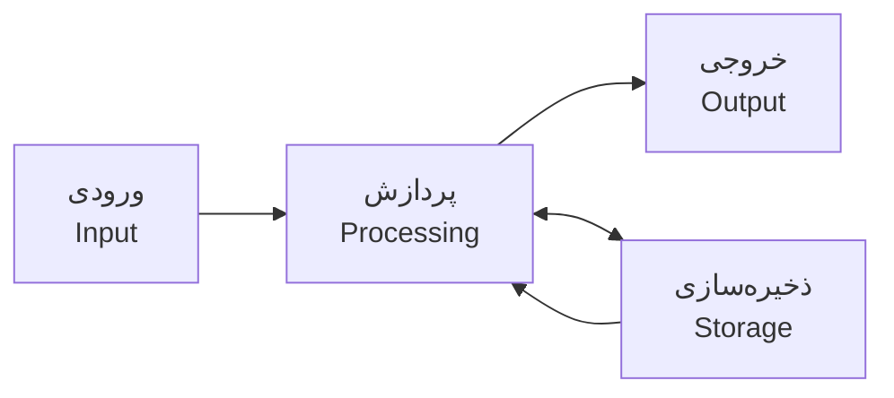
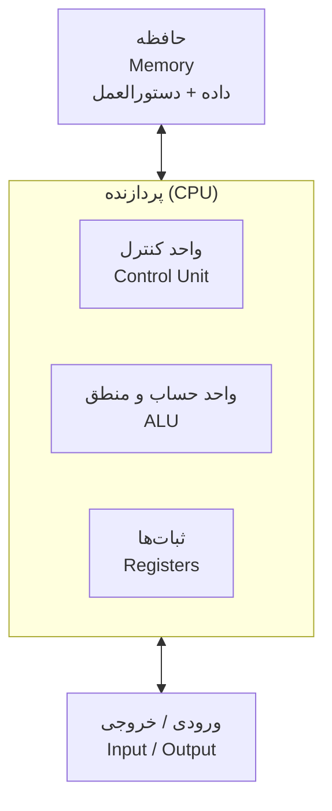

# 01. کامپیوتر چیست؟ (What Is a Computer?)

## معرفی

کامپیوتر دستگاهی است که می‌تواند داده را دریافت کند، طبق مجموعه‌ای از دستورالعمل‌ها روی آن عملیات انجام دهد، نتیجه را تولید کند و در صورت نیاز آن را نگه دارد. این تعریف ساده به نظر می‌رسد، اما تقریباً تمام موضوعات علوم کامپیوتر و بخش بزرگی از امنیت سایبری به اجزای همین تعریف برمی‌گردند.

برای مثال، وقتی رمز عبور خود را در یک وب‌سایت وارد می‌کنید، دستگاه شما ورودی را دریافت می‌کند؛ نرم‌افزار آن را پردازش می‌کند؛ سیستم‌عامل و سخت‌افزار در اجرای عملیات نقش دارند؛ داده از طریق شبکه جابه‌جا می‌شود؛ و در نهایت سرور نتیجه‌ای را برمی‌گرداند. برای تحلیل امنیت چنین فرایندی، باید بدانیم «داده»، «دستورالعمل»، «پردازش» و «ذخیره‌سازی» چه معنایی دارند.

در این درس هنوز وارد جزئیات مدارها، طراحی CPU یا سیستم‌عامل نمی‌شویم. هدف، ساختن یک مدل ذهنی دقیق و مشترک است تا در درس‌های بعدی بتوانیم هر بخش را جداگانه عمیق‌تر بررسی کنیم.

## اهداف یادگیری

پس از مطالعه و انجام تمرین‌های این درس باید بتوانید:

- کامپیوتر و سیستم محاسباتی را با زبان خود تعریف کنید.
- نقش ورودی، پردازش، خروجی و ذخیره‌سازی را از هم تشخیص دهید.
- سخت‌افزار، نرم‌افزار، داده و دستورالعمل را از یکدیگر تفکیک کنید.
- توضیح دهید برنامه چگونه رفتار یک کامپیوتر عمومی را تعیین می‌کند.
- ایدهٔ Stored-Program را در سطح مفهومی شرح دهید.
- مدل ساده‌شدهٔ Von Neumann را بشناسید و محدودیت‌های آن را بیان کنید.

## ۱. سیستم چیست؟

**سیستم (System)** مجموعه‌ای از اجزای مرتبط است که برای انجام یک یا چند هدف با یکدیگر تعامل می‌کنند. هر جزء به‌تنهایی ممکن است کار مشخصی انجام دهد، اما رفتار کل سیستم از همکاری اجزا به وجود می‌آید.

برای مثال، یک سیستم تهویه می‌تواند حسگر دما، کنترل‌کننده، فن و خروجی هوا داشته باشد. حسگر وضعیت محیط را اندازه می‌گیرد، کنترل‌کننده مقدار اندازه‌گیری‌شده را ارزیابی می‌کند و فن بر اساس تصمیم کنترل‌کننده فعال یا غیرفعال می‌شود.

یک سیستم محاسباتی نیز از اجزایی تشکیل شده که داده را دریافت، نگهداری، جابه‌جا یا پردازش می‌کنند. این اجزا ممکن است سخت‌افزاری، نرم‌افزاری یا ترکیبی از هر دو باشند.

**نکته:** هر سیستمی الزاماً کامپیوتر نیست. اما کامپیوتر را می‌توان یک سیستم محاسباتی در نظر گرفت؛ یعنی سیستمی که عملیات روی داده را طبق قواعد و دستورالعمل‌ها انجام می‌دهد.

## ۲. مدل پایهٔ یک سیستم محاسباتی

برای شروع، رفتار یک سیستم محاسباتی را با چهار فعالیت اصلی توصیف می‌کنیم:

1. **ورودی (Input):** دریافت داده یا سیگنال از محیط یا اجزای دیگر.
2. **پردازش (Processing):** انجام عملیات روی داده، بر اساس دستورالعمل‌ها و وضعیت فعلی سیستم.
3. **خروجی (Output):** ارائهٔ نتیجه به کاربر، دستگاه دیگر یا محیط.
4. **ذخیره‌سازی (Storage):** نگهداری داده یا نتیجه برای استفادهٔ بعدی.

این چهار مورد یک مدل آموزشی ساده‌اند، نه چهار قطعهٔ فیزیکی مستقل. برای مثال، یک دستگاه می‌تواند هم‌زمان داده دریافت و پردازش کند یا نتیجه را بدون نمایش به کاربر، به سیستم دیگری بفرستد.

### نمودار مدل پایه

### یک مثال: ماشین‌حساب

فرض کنید عبارت `12 + 30` را در ماشین‌حساب وارد می‌کنید:

- **ورودی:** کلیدهای ۱، ۲، +، ۳ و ۰ را فشار می‌دهید.
- **پردازش:** دستگاه باید عمل جمع را طبق قواعد تعریف‌شده انجام دهد.
- **خروجی:** عدد ۴۲ روی نمایشگر ظاهر می‌شود.
- **ذخیره‌سازی:** بسته به نوع ماشین‌حساب، ممکن است ورودی یا نتیجه در حافظهٔ موقت نگهداری شود؛ یا اصلاً نیازی به نگهداری بلندمدت نباشد.

این مثال نشان می‌دهد که وجود هر چهار فعالیت لزوماً به معنی وجود چهار قطعهٔ جداگانه نیست.

### مثال دوم: دستگاه خودپرداز (ATM)

در یک ATM، کارت، رمز واردشده و انتخاب مبلغ نمونه‌هایی از ورودی هستند. نرم‌افزار دستگاه و سامانهٔ بانکی درخواست را پردازش می‌کنند. نمایش پیام، تحویل وجه نقد و چاپ رسید خروجی‌اند. اطلاعات حساب و سوابق تراکنش نیز در سامانه‌های ذخیره‌سازی نگهداری می‌شوند.

| فعالیت | نمونه در ATM |
|---|---|
| ورودی | کارت، رمز، انتخاب عملیات و مبلغ |
| پردازش | بررسی درخواست، احراز هویت و کنترل موجودی |
| خروجی | پیام روی صفحه، وجه نقد و رسید |
| ذخیره‌سازی | سوابق تراکنش و اطلاعات حساب |

دقت کنید که پردازش ATM فقط داخل همان دستگاه انجام نمی‌شود. بخشی از تصمیم‌گیری ممکن است در سرور بانک انجام شود. بنابراین مرز یک سیستم را باید با توجه به مسئله‌ای که بررسی می‌کنیم مشخص کنیم.

## ۳. داده و دستورالعمل یکسان نیستند

برای درک کامپیوتر باید بین دو مفهوم تفاوت بگذاریم:

- **داده (Data):** مقادیری که سیستم آن‌ها را دریافت، نگهداری یا پردازش می‌کند.
- **دستورالعمل (Instruction):** عملیاتی که سیستم باید انجام دهد.

برای نمونه، در یک برنامهٔ ساده، عددهای ۱۲ و ۳۰ داده هستند؛ اما دستور «این دو مقدار را جمع کن» یک دستورالعمل است.

این تفکیک از نظر امنیتی هم مهم است. بسیاری از آسیب‌پذیری‌ها زمانی شکل می‌گیرند که یک سیستم، دادهٔ کنترل‌نشده را به‌اشتباه به‌عنوان دستور یا ورودی قابل‌اعتماد تفسیر کند. برای مثال، در SQL Injection ورودی مهاجم ممکن است به‌جای آنکه صرفاً یک مقدار داده تلقی شود، بخشی از ساختار دستور SQL شود. جزئیات این آسیب‌پذیری در بخش امنیت وب بررسی خواهد شد؛ فعلاً نکتهٔ پایه این است که **داده و دستورالعمل از نظر معنایی دو نقش متفاوت دارند، هرچند هر دو در نهایت به شکل بیت‌ها نمایش داده می‌شوند.**

## ۴. سخت‌افزار و نرم‌افزار

### سخت‌افزار (Hardware)

سخت‌افزار به اجزای فیزیکی یک سیستم کامپیوتری گفته می‌شود؛ اجزایی که می‌توان آن‌ها را از نظر فیزیکی لمس یا اندازه‌گیری کرد. نمونه‌ها:

- پردازنده (CPU)
- حافظهٔ اصلی (RAM)
- دستگاه ذخیره‌سازی مانند SSD
- صفحه‌کلید و نمایشگر
- کارت شبکه

### نرم‌افزار (Software)

نرم‌افزار مجموعه‌ای سازمان‌یافته از برنامه‌ها، داده‌ها و منابع مرتبط است که به سیستم می‌گوید چه کارهایی انجام دهد یا امکاناتی را در اختیار کاربر و برنامه‌های دیگر قرار می‌دهد.

نمونه‌ها:

- سیستم‌عامل
- مرورگر وب
- ویرایشگر متن
- بازی
- برنامه‌ای که خودتان می‌نویسید

سخت‌افزار و نرم‌افزار دو دنیای جدا از هم نیستند؛ آن‌ها برای اجرای یک کار با یکدیگر همکاری می‌کنند. نرم‌افزار دستورالعمل‌ها و منطق موردنیاز را فراهم می‌کند و سخت‌افزار عملیات را اجرا می‌کند. سیستم‌عامل نیز منابع سخت‌افزاری را مدیریت کرده و واسطه‌ای میان برنامه‌ها و بسیاری از جزئیات دستگاه ایجاد می‌کند.

## ۵. برنامه چیست؟

**برنامه (Program)** مجموعه‌ای از دستورالعمل‌های سازمان‌یافته است که برای انجام یک وظیفه طراحی شده‌اند. برنامه می‌تواند داده دریافت کند، بر اساس آن تصمیم بگیرد، عملیات انجام دهد و نتیجه تولید کند.

برای مثال، یک برنامهٔ جمع ساده ممکن است از نظر مفهومی چنین مراحلی داشته باشد:

1. دو مقدار را دریافت کن.
2. مقدار اول و دوم را با هم جمع کن.
3. نتیجه را نمایش بده.

این توصیف هنوز به زبان برنامه‌نویسی خاصی وابسته نیست. یک برنامه‌نویس می‌تواند این منطق را با زبان‌های مختلف پیاده‌سازی کند. پس از ساخت برنامه نیز سیستم باید آن را به شکلی اجرا کند که سخت‌افزار و محیط اجرایی بتوانند بفهمند؛ این مسیر را در درس «نحوه اجرای برنامه‌ها» دقیق‌تر بررسی می‌کنیم.

## ۶. ایدهٔ Stored-Program

در بسیاری از کامپیوترهای عمومی امروزی، دستورالعمل‌های برنامه در حافظه نگهداری می‌شوند و پردازنده آن‌ها را دریافت و اجرا می‌کند. به این ایده **Stored-Program Concept** یا مفهوم «برنامهٔ ذخیره‌شده» گفته می‌شود.

اهمیت این ایده در این است که برای انجام هر وظیفهٔ جدید، لازم نیست مدارهای سخت‌افزاری دستگاه را از نو طراحی کنیم. می‌توان برنامهٔ دیگری را در سیستم قرار داد تا همان سخت‌افزار، رفتار متفاوتی نشان دهد.

برای مثال، یک لپ‌تاپ با سخت‌افزار یکسان می‌تواند مرورگر، ویرایشگر تصویر، کامپایلر یا بازی اجرا کند. تفاوت اصلی در دستورالعمل‌ها و داده‌هایی است که در هر لحظه اجرا و پردازش می‌شوند.

این موضوع به معنی آن نیست که «هر نوع داده‌ای خودبه‌خود قابل اجراست» یا همهٔ سیستم‌ها دقیقاً یک روش ذخیره‌سازی برنامه دارند. معماری‌ها و محیط‌های اجرایی متفاوت‌اند؛ اما مفهوم برنامهٔ ذخیره‌شده، مدل پایهٔ مهمی برای فهم رایانه‌های عمومی است.

## ۷. آشنایی مقدماتی با مدل Von Neumann

مدل **Von Neumann** یکی از مدل‌های کلاسیک برای توضیح سازمان‌دهی یک کامپیوتر است. در شکل ساده‌شدهٔ این مدل، دستورالعمل‌ها و داده‌ها در یک فضای حافظهٔ مشترک نگهداری می‌شوند و پردازنده آن‌ها را از حافظه دریافت و پردازش می‌کند.

اجزای مفهومی این مدل عبارت‌اند از:

- **Memory:** نگهداری دستورالعمل‌ها و داده‌ها.
- **Control Unit:** هدایت اجرای دستورالعمل‌ها.
- **ALU:** انجام عملیات حسابی و منطقی.
- **Input/Output:** ارتباط سیستم با محیط بیرونی.

این نمودار **نمایی مفهومی و ساده‌شده** است؛ یک نقشهٔ دقیق از اتصالات داخلی پردازنده یا مادربرد نیست. در درس‌های معماری کامپیوتر، اجزای CPU، رجیسترها، حافظه و مسیر ارتباطی آن‌ها را دقیق‌تر بررسی خواهیم کرد.

### محدودیت مهم مدل

مدل Von Neumann برای آموزش بسیار مفید است، اما همهٔ جزئیات سیستم‌های مدرن را نمایش نمی‌دهد. پردازنده‌های امروزی ممکن است Cacheهای چندسطحی، Pipeline، چندین واحد اجرایی و سازوکارهای پیچیدهٔ پیش‌بینی و اجرای دستورالعمل داشته باشند. همچنین برخی معماری‌ها یا بخش‌های سیستم از جداسازی حافظهٔ دستورالعمل و داده استفاده می‌کنند.

پس از این مدل به‌عنوان **نقطهٔ شروع برای استدلال** استفاده کنید، نه تصویری کامل از سخت‌افزار مدرن.

## ۸. یک نگاه سیستمی به اجرای یک برنامه

وقتی یک برنامه را باز می‌کنید، چندین جزء درگیر می‌شوند:

1. کاربر از طریق ورودی، درخواست خود را اعلام می‌کند.
2. سیستم‌عامل اجرای برنامه را مدیریت می‌کند.
3. دستورالعمل‌ها و داده‌های موردنیاز در حافظه قرار می‌گیرند.
4. CPU دستورالعمل‌ها را اجرا می‌کند.
5. برنامه ممکن است با فایل‌ها، شبکه یا دستگاه‌های ورودی و خروجی تعامل کند.
6. نتیجه به کاربر نمایش داده می‌شود یا در جایی ذخیره می‌شود.

این فهرست عمداً ساده شده است. برای مثال، برنامه ممکن است چندین بار داده را از دیسک بخواند، از سرویس شبکه پاسخ بگیرد یا از کتابخانه‌های دیگر استفاده کند. در درس‌های بعدی، هرکدام از این تعامل‌ها را دقیق‌تر باز می‌کنیم.

## ۹. چرا این مفاهیم برای امنیت سایبری مهم‌اند؟

امنیت سایبری فقط شناخت ابزارها یا اجرای فرمان‌ها نیست؛ بخش مهمی از آن فهمیدن رفتار سیستم و مرز میان اجزای آن است.

چند نمونه از ارتباط مفاهیم این درس با امنیت:

- **تفکیک داده و دستورالعمل:** پایهٔ فهم Injection و بسیاری از خطاهای اعتبارسنجی ورودی است.
- **نرم‌افزار و سخت‌افزار:** برای تحلیل آسیب‌پذیری‌هایی مانند خطاهای حافظه و رفتار پردازنده ضروری است.
- **برنامهٔ ذخیره‌شده:** در فهم فایل اجرایی، بدافزار، بارگذاری برنامه و مهندسی معکوس کاربرد دارد.
- **ورودی و خروجی:** برای تحلیل سطح حمله، مرز اعتماد و مسیر ورود داده به سیستم اهمیت دارد.
- **ذخیره‌سازی:** در بررسی ماندگاری داده، آثار دیجیتال، فایل‌سیستم و بازیابی اطلاعات نقش دارد.

فعلاً لازم نیست این حوزه‌ها را عمیق بدانید. هدف این است که از همان ابتدا ارتباط مبانی کامپیوتر با موضوعات امنیتی برایتان روشن باشد.

## ۱۰. جمع‌بندی

یک کامپیوتر را می‌توان سیستمی دانست که داده را دریافت و نگهداری می‌کند، طبق دستورالعمل‌ها روی آن عملیات انجام می‌دهد و نتیجه را در اختیار کاربر یا سیستم دیگری قرار می‌دهد.

برای ادامهٔ مسیر، این تفاوت‌ها را به خاطر بسپارید:

| مفهوم | معنی |
|---|---|
| Data | مقادیری که سیستم با آن‌ها کار می‌کند |
| Instruction | عملیاتی که باید انجام شود |
| Program | مجموعه‌ای سازمان‌یافته از دستورالعمل‌ها |
| Hardware | اجزای فیزیکی سیستم |
| Software | برنامه‌ها و منابع نرم‌افزاری |
| Input | دریافت داده یا سیگنال |
| Processing | انجام عملیات روی داده |
| Output | ارائهٔ نتیجه |
| Storage | نگهداری داده یا نتیجه |

در درس بعدی، روی داده و اطلاعات و سپس واحدهای اندازه‌گیری مانند bit و byte تمرکز می‌کنیم. این واژگان برای فهم نمایش داده در سطح بیتی ضروری‌اند.

## تمرین‌ها

تمرین‌ها را بدون مراجعهٔ فوری به پاسخ آماده حل کنید. هدف، توانایی توضیح مفاهیم با زبان خودتان است.

### تمرین ۱ — تشخیص اجزای سیستم

یک تلفن همراه را انتخاب کنید و برای هر مورد حداقل دو نمونه بنویسید:

- ورودی
- پردازش
- خروجی
- ذخیره‌سازی

سپس مشخص کنید کدام نمونه‌ها به سخت‌افزار و کدام به نرم‌افزار مربوط‌اند. بعضی فعالیت‌ها به همکاری هر دو نیاز دارند؛ آن موارد را جداگانه توضیح دهید.

### تمرین ۲ — تحلیل یک سناریو

فرض کنید در یک برنامهٔ ویرایش متن، جمله‌ای تایپ می‌کنید و فایل را ذخیره می‌کنید.

1. ورودی چیست؟
2. کدام بخش‌ها در پردازش دخیل‌اند؟
3. خروجی را کجا مشاهده می‌کنید؟
4. هنگام ذخیره‌سازی چه چیزی باید نگهداری شود؟
5. آیا نمایش متن روی صفحه به‌تنهایی به معنی ذخیره‌شدن آن روی دیسک است؟ چرا؟

### تمرین ۳ — داده یا دستورالعمل؟

هر مورد را به‌عنوان داده، دستورالعمل یا ترکیبی از این دو تحلیل کنید:

- عدد 42
- دستور «دو مقدار را جمع کن»
- نام یک فایل
- برنامه‌ای که فایل را باز می‌کند
- متنی که کاربر در یک فرم وارد کرده است

برای مواردی که به زمینه وابسته‌اند، توضیح دهید چرا یک پاسخ ثابت کافی نیست.

### تمرین ۴ — Stored-Program

توضیح دهید مفهوم Stored-Program چه تفاوتی در ساخت و استفاده از کامپیوترهای عمومی ایجاد می‌کند. پاسخ را با مقایسهٔ یک دستگاه با عملکرد ثابت و یک رایانهٔ قابل اجرای برنامه‌های گوناگون کامل کنید.

### تمرین ۵ — محدودیت مدل

دو مورد از جزئیاتی را نام ببرید که نمودار سادهٔ Von Neumann نشان نمی‌دهد. توضیح دهید چرا با وجود این محدودیت‌ها، این مدل هنوز برای آموزش مفید است.

## آزمایش عملی

### بررسی اجزای سیستم خودتان

در این آزمایش نیازی به نصب ابزار یا نوشتن کد ندارید.

1. اطلاعات سیستم‌عامل خود را باز کنید.
2. مدل پردازنده و مقدار حافظهٔ RAM را پیدا کنید.
3. نوع دستگاه ذخیره‌سازی را در صورت امکان شناسایی کنید.
4. حداقل دو دستگاه ورودی و دو دستگاه خروجی را فهرست کنید.
5. یک برنامهٔ ساده را اجرا کنید و مسیر ورودی، پردازش و خروجی آن را توصیف کنید.

**گزارش آزمایش** را با این قالب بنویسید:

| مورد | مشاهدهٔ شما |
|---|---|
| سیستم‌عامل | |
| پردازنده | |
| حافظهٔ RAM | |
| دستگاه ذخیره‌سازی | |
| دو دستگاه ورودی | |
| دو دستگاه خروجی | |
| برنامهٔ انتخاب‌شده | |
| ورودی، پردازش و خروجی برنامه | |

### معیار پایان درس

وقتی بتوانید بدون حفظ‌کردن متن، یک سیستم واقعی را با مفاهیم ورودی، پردازش، خروجی، ذخیره‌سازی، سخت‌افزار، نرم‌افزار، داده و دستورالعمل تحلیل کنید، این درس را به‌اندازهٔ کافی یاد گرفته‌اید. لازم نیست همهٔ جزئیات معماری را همین حالا بدانید؛ آن‌ها در درس‌های بعدی ساخته می‌شوند.

## منابع برای مطالعهٔ بیشتر

این منابع برای تعمیق مفاهیم درس مناسب‌اند:

1. **Code: The Hidden Language of Computer Hardware and Software — Charles Petzold**  
   برای ساختن درک شهودی از اینکه کامپیوتر چگونه از اجزای ساده‌تر ساخته می‌شود.
2. **Computer Organization and Design — David A. Patterson and John L. Hennessy**  
   برای مطالعهٔ دقیق‌تر سازمان‌دهی کامپیوتر، دستورالعمل‌ها و مسیر اجرای آن‌ها.
3. **Computer Systems: A Programmer's Perspective — Randal E. Bryant and David R. O'Hallaron**  
   برای پیوند دادن برنامه‌نویسی با نمایش داده و رفتار سیستم در سطح ماشین.

برای این درس، خواندن کامل این کتاب‌ها لازم نیست. متن اصلی و تمرین‌ها را تمام کنید؛ سپس اگر به توضیح عمیق‌تر نیاز داشتید، از بخش‌های مرتبط منابع استفاده کنید.

---

<small>نسخهٔ آموزشی اولیه — بازبینی فنی و ویرایشی در جریان توسعهٔ پروژه انجام می‌شود.</small>
